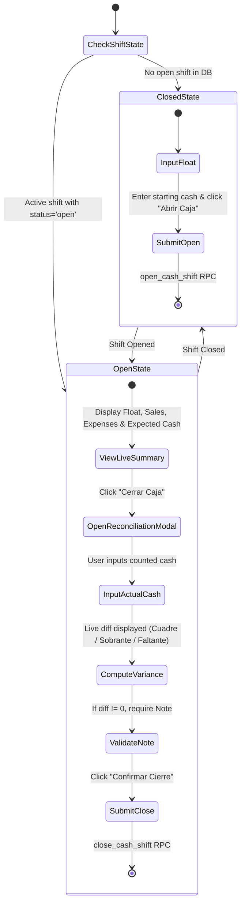

# Design: Manage Cash Shifts and Register Reconciliation

## Context

In retail and minimarket environments, cash handling requires accountability to prevent undetected theft, cash shrinkage, and counting errors. Every cashier shift starts with an initial cash float (fondo de caja) and must conclude with a formal cash count reconciliation (arqueo de caja). 

This design establishes the `cash_shifts` domain, enforcing single-shift exclusivity per business, real-time balance aggregation, and audited closing reconciliations with mandatory discrepancy justifications.

## Goals / Non-Goals

**Goals:**
- Provide a database structure for `cash_shifts` with strict multi-tenant Row Level Security (RLS) linked to `businesses(id)`.
- Enforce the invariant that **only one open shift can exist per business** using a PostgreSQL partial unique index.
- Implement atomic RPC functions for opening and closing shifts.
- Build the `/dashboard/cash-register` screen handling both "Closed" and "Open" operational states.
- Support real-time cash balance monitoring:
  $$\text{Expected Cash} = \text{Initial Float} + \text{Cash Sales} + \text{Digital Sales} - \text{Cash Expenses}$$
- Implement a cash reconciliation modal with live difference evaluation:
  $$\text{Difference} = \text{Actual Counted Cash} - \text{Expected Cash}$$
  Enforcing a mandatory justification note whenever $\text{Difference} \neq 0$.
- Display a persistent status indicator ("Caja Abierta" / "Caja Cerrada") in the Treinta-inspired navigation shell.
- Provide a comprehensive historical audit log of all past shifts.

**Non-Goals:**
- Multi-drawer/multi-terminal setups under the same business (a single unified register is tracked per business in this phase).
- Direct physical cash drawer hardware drivers or printer ESC/POS protocols (handled in future hardware integration specs).

## Decisions

### 1. Database Architecture & Exact SQL Schema

```sql
-- Migration: supabase/migrations/20261118000002_manage_cash_shifts.sql

-- 1. Create cash_shifts table
create table if not exists public.cash_shifts (
  id uuid primary key default gen_random_uuid(),
  business_id uuid not null references public.businesses(id) on delete cascade,
  opened_by uuid not null references auth.users(id),
  closed_by uuid references auth.users(id),
  opened_at timestamptz not null default now(),
  closed_at timestamptz,
  initial_cash numeric(12, 2) not null check (initial_cash >= 0),
  expected_cash numeric(12, 2),
  actual_cash numeric(12, 2) check (actual_cash is null or actual_cash >= 0),
  difference numeric(12, 2),
  notes text,
  status text not null default 'open' check (status in ('open', 'closed')),
  created_at timestamptz not null default now(),
  updated_at timestamptz not null default now()
);

-- 2. Partial unique index enforcing only ONE open shift per business
create unique index if not exists uq_one_open_shift_per_business
  on public.cash_shifts(business_id)
  where status = 'open';

-- Index for historical queries
create index if not exists idx_cash_shifts_business_created
  on public.cash_shifts(business_id, created_at desc);

-- 3. Row Level Security Policies
alter table public.cash_shifts enable row level security;

create policy "Users can view cash shifts for their business"
  on public.cash_shifts for select
  to authenticated
  using (business_id in (select public.get_user_business_ids()));

create policy "Staff can open cash shifts"
  on public.cash_shifts for insert
  to authenticated
  with check (
    business_id in (select public.get_user_business_ids())
    and public.get_business_role(business_id) in ('owner', 'manager', 'cashier')
  );

create policy "Staff can close and update active cash shifts"
  on public.cash_shifts for update
  to authenticated
  using (
    business_id in (select public.get_user_business_ids())
    and public.get_business_role(business_id) in ('owner', 'manager', 'cashier')
  )
  with check (
    business_id in (select public.get_user_business_ids())
    and public.get_business_role(business_id) in ('owner', 'manager', 'cashier')
  );

-- 4. Atomic RPC to Open Cash Shift
create or replace function public.open_cash_shift(
  p_business_id uuid,
  p_initial_cash numeric
)
returns public.cash_shifts
language plpgsql
security definer
set search_path = public
as $$
declare
  v_user_id uuid;
  v_shift public.cash_shifts;
begin
  v_user_id := auth.uid();
  if v_user_id is null then
    raise exception 'Unauthorized';
  end if;

  if not public.is_business_member(p_business_id) then
    raise exception 'User is not a member of this business';
  end if;

  if p_initial_cash < 0 then
    raise exception 'Initial cash float cannot be negative';
  end if;

  -- Verify no open shift exists
  if exists (
    select 1 from public.cash_shifts
    where business_id = p_business_id and status = 'open'
  ) then
    raise exception 'There is already an open cash shift for this business';
  end if;

  insert into public.cash_shifts (
    business_id, opened_by, initial_cash, status
  ) values (
    p_business_id, v_user_id, p_initial_cash, 'open'
  )
  returning * into v_shift;

  return v_shift;
end;
$$;

-- 5. Atomic RPC to Close Cash Shift
create or replace function public.close_cash_shift(
  p_shift_id uuid,
  p_actual_cash numeric,
  p_notes text default null
)
returns public.cash_shifts
language plpgsql
security definer
set search_path = public
as $$
declare
  v_user_id uuid;
  v_shift public.cash_shifts;
  v_expected_cash numeric;
  v_difference numeric;
begin
  v_user_id := auth.uid();
  if v_user_id is null then
    raise exception 'Unauthorized';
  end if;

  -- Lock row for update
  select * into v_shift
  from public.cash_shifts
  where id = p_shift_id
  for update;

  if not found then
    raise exception 'Cash shift not found';
  end if;

  if v_shift.status <> 'open' then
    raise exception 'Cash shift is already closed';
  end if;

  if not public.is_business_member(v_shift.business_id) then
    raise exception 'Unauthorized to close this cash shift';
  end if;

  if p_actual_cash < 0 then
    raise exception 'Actual cash cannot be negative';
  end if;

  -- Baseline calculation: Initial float + cash sales - cash expenses
  -- Note: When sales/expenses tables are linked, query their sums here; defaults to initial_cash
  v_expected_cash := coalesce(v_shift.expected_cash, v_shift.initial_cash);
  v_difference := p_actual_cash - v_expected_cash;

  -- Validate mandatory note when difference is non-zero
  if v_difference <> 0 and trim(coalesce(p_notes, '')) = '' then
    raise exception 'A justification note is required when there is a cash difference (Difference: %)', v_difference;
  end if;

  update public.cash_shifts
  set status = 'closed',
      closed_by = v_user_id,
      closed_at = now(),
      actual_cash = p_actual_cash,
      expected_cash = v_expected_cash,
      difference = v_difference,
      notes = nullif(trim(p_notes), ''),
      updated_at = now()
  where id = p_shift_id
  returning * into v_shift;

  return v_shift;
end;
$$;
```

### 2. UI State Machine & Component Structure



### 3. Screen Decomposition (`/dashboard/cash-register`)

- **State A (Register Closed)**:
  - Hero card: "Caja Cerrada" with explanatory copy.
  - Input: `Fondo inicial` with currency symbol prefix.
  - Quick amount pills: `[$5,000, $10,000, $20,000, $50,000]`.
  - Button: "Abrir Caja".
- **State B (Register Open)**:
  - Summary Bar: Opened by User, Open Date & Time, Elapsed Duration.
  - Metric Grid:
    - `Fondo inicial`: starting cash.
    - `Ventas en efectivo`: sum of cash payment sales.
    - `Ventas electrónicas`: sum of card/transfer sales.
    - `Gastos en efectivo`: withdrawals / expenses.
    - `Efectivo esperado`: prominent highlighted card showing calculated drawer cash.
  - Primary Action: "Cerrar Caja" button styled in amber/slate.
- **Reconciliation Modal ("Arqueo de Caja")**:
  - Expected cash display.
  - Number input: `Efectivo real contado`.
  - Dynamic status badge:
    - Difference = $0.00 $\rightarrow$ `✓ Caja cuadrada` (Green).
    - Difference > $0.00 $\rightarrow$ `↑ Sobrante: +$X` (Blue/Green).
    - Difference < $0.00 $\rightarrow$ `↓ Faltante: -$X` (Red).
  - Justification field: `<textarea>` marked with required asterisk and validation error if empty when difference is non-zero.
- **Audit History Table (Bottom section)**:
  - Rows sorted by `closed_at DESC`.
  - Columns: Fecha de Cierre, Abierto por, Cerrado por, Inicial, Esperado, Real, Diferencia (badge color-coded), Notas / Justificación.

### 4. Global Shell Status Indicator

- Client hook or server layout fetcher resolves active shift status for the current business.
- Navigation Sidebar & Mobile Header render:
  - `Caja Abierta` with a pulsing green indicator dot.
  - `Caja Cerrada` with a subtle gray/amber indicator dot.
  - Clicking the badge navigates directly to `/dashboard/cash-register`.

## Risks / Trade-offs

- **Concurrent Close Attempts**:
  - *Risk*: Two cashiers attempt to close the same shift simultaneously.
  - *Mitigation*: The `close_cash_shift` RPC utilizes `FOR UPDATE` row-level locking on the shift record; subsequent concurrent attempts find `status <> 'open'` and are safely rejected.
- **Unlinked Sales Before POS Module Implementation**:
  - *Risk*: Sales and expenses modules are built in subsequent iterations.
  - *Mitigation*: The `expected_cash` logic is designed to read `initial_cash` as base and incorporates sales/expense aggregates seamlessly once transaction tables exist.
