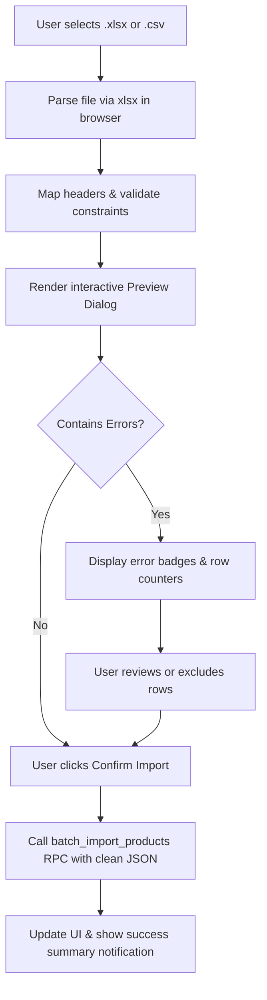

# Design: Manage Product Catalog and Inventory

## Context

Following the foundational multi-tenant architecture introduced in `setup-auth-and-business`, the application requires its primary commercial module: the product catalog and inventory manager. In a retail/minimarket environment (inspired by Treinta), store owners and managers need fast stock visibility, profit margin insight, quick adjustments for deliveries or shrinkage, and the ability to upload bulk inventories from Excel/CSV spreadsheets.

## Goals / Non-Goals

**Goals:**
- Implement multi-tenant `categories` and `products` tables secured with Row Level Security (RLS) linked to `businesses(id)`.
- Configure a dedicated Supabase Storage bucket (`product-images`) with tenant-isolated access policies.
- Build a responsive `/dashboard/inventory` screen featuring:
  - Metric summary cards (Total Products, Inventory Valuation at Cost, Low Stock Alerts).
  - Searchable table filtering by name, barcode, category, and "Low stock only" toggle.
  - Create/Edit drawer with photo upload, cost and sale price inputs, and dynamic gross margin calculation.
  - Rapid stock adjustment mechanism (+/- stock) with atomic database execution.
- Implement client-side spreadsheet import using `xlsx` (SheetJS) with downloadable template, pre-import validation preview, and batch upsert with auto-provisioning of missing categories.

**Non-Goals:**
- Purchase orders, supplier tracking, and detailed supplier invoicing (deferred to a dedicated procurement change).
- Multi-warehouse/multi-location stock tracking (each business has a single unified stock balance in this phase).
- Product variants (e.g., size/color matrices); each SKU is a distinct product record.

## Decisions

### 1. Database Architecture & Exact SQL Schema

```sql
-- Migration: supabase/migrations/20261118000001_manage_product_catalog.sql

-- 1. Create categories table
create table if not exists public.categories (
  id uuid primary key default gen_random_uuid(),
  business_id uuid not null references public.businesses(id) on delete cascade,
  name text not null,
  created_at timestamptz not null default now(),
  updated_at timestamptz not null default now(),
  constraint uq_category_per_business unique (business_id, name)
);

create index if not exists idx_categories_business_id on public.categories(business_id);

-- 2. Create products table
create table if not exists public.products (
  id uuid primary key default gen_random_uuid(),
  business_id uuid not null references public.businesses(id) on delete cascade,
  category_id uuid references public.categories(id) on delete set null,
  barcode text,
  name text not null,
  cost_price numeric(12, 2) not null default 0.00 check (cost_price >= 0),
  sale_price numeric(12, 2) not null default 0.00 check (sale_price >= 0),
  stock numeric(12, 2) not null default 0.00 check (stock >= 0),
  min_stock numeric(12, 2) not null default 5.00 check (min_stock >= 0),
  image_url text,
  is_active boolean not null default true,
  created_at timestamptz not null default now(),
  updated_at timestamptz not null default now()
);

-- Partial unique index on barcode per business (allows null/empty barcodes without collision)
create unique index if not exists uq_product_barcode_per_business
  on public.products(business_id, barcode)
  where barcode is not null and barcode <> '';

-- Search and filter indexes
create index if not exists idx_products_business_active on public.products(business_id, is_active);
create index if not exists idx_products_business_category on public.products(business_id, category_id);
create index if not exists idx_products_business_name on public.products(business_id, name);
create index if not exists idx_products_business_low_stock on public.products(business_id) where stock <= min_stock;

-- 3. Row Level Security Policies (categories)
alter table public.categories enable row level security;

create policy "Users can view categories for their business"
  on public.categories for select
  to authenticated
  using (business_id in (select public.get_user_business_ids()));

create policy "Owners and managers can insert categories"
  on public.categories for insert
  to authenticated
  with check (
    business_id in (select public.get_user_business_ids())
    and public.get_business_role(business_id) in ('owner', 'manager')
  );

create policy "Owners and managers can update categories"
  on public.categories for update
  to authenticated
  using (
    business_id in (select public.get_user_business_ids())
    and public.get_business_role(business_id) in ('owner', 'manager')
  )
  with check (
    business_id in (select public.get_user_business_ids())
    and public.get_business_role(business_id) in ('owner', 'manager')
  );

create policy "Owners and managers can delete categories"
  on public.categories for delete
  to authenticated
  using (
    business_id in (select public.get_user_business_ids())
    and public.get_business_role(business_id) in ('owner', 'manager')
  );

-- 4. Row Level Security Policies (products)
alter table public.products enable row level security;

create policy "Users can view products for their business"
  on public.products for select
  to authenticated
  using (business_id in (select public.get_user_business_ids()));

create policy "Owners and managers can insert products"
  on public.products for insert
  to authenticated
  with check (
    business_id in (select public.get_user_business_ids())
    and public.get_business_role(business_id) in ('owner', 'manager')
  );

create policy "Staff can update products (pricing and stock)"
  on public.products for update
  to authenticated
  using (
    business_id in (select public.get_user_business_ids())
    and public.get_business_role(business_id) in ('owner', 'manager', 'cashier')
  )
  with check (
    business_id in (select public.get_user_business_ids())
    and public.get_business_role(business_id) in ('owner', 'manager', 'cashier')
  );

create policy "Owners and managers can delete products"
  on public.products for delete
  to authenticated
  using (
    business_id in (select public.get_user_business_ids())
    and public.get_business_role(business_id) in ('owner', 'manager')
  );

-- 5. Atomic Stock Adjustment RPC
create or replace function public.adjust_product_stock(
  p_product_id uuid,
  p_delta numeric,
  p_reason text default 'manual_adjustment'
)
returns public.products
language plpgsql
security definer
set search_path = public
as $$
declare
  v_product public.products;
  v_new_stock numeric;
begin
  -- Fetch product and check membership
  select * into v_product
  from public.products
  where id = p_product_id;

  if not found then
    raise exception 'Product not found';
  end if;

  if not public.is_business_member(v_product.business_id) then
    raise exception 'Unauthorized to modify products for this business';
  end if;

  v_new_stock := v_product.stock + p_delta;
  if v_new_stock < 0 then
    raise exception 'Stock cannot be negative (current: %, adjustment: %)', v_product.stock, p_delta;
  end if;

  update public.products
  set stock = v_new_stock,
      updated_at = now()
  where id = p_product_id
  returning * into v_product;

  return v_product;
end;
$$;

-- 6. Batch Upsert Products RPC (with auto-category resolution)
create or replace function public.batch_import_products(
  p_business_id uuid,
  p_rows jsonb
)
returns jsonb
language plpgsql
security definer
set search_path = public
as $$
declare
  v_row jsonb;
  v_cat_name text;
  v_cat_id uuid;
  v_inserted integer := 0;
  v_updated integer := 0;
  v_cat_created integer := 0;
  v_barcode text;
  v_name text;
  v_cost numeric;
  v_sale numeric;
  v_stock numeric;
  v_min_stock numeric;
  v_existing_id uuid;
begin
  if not public.is_business_member(p_business_id) or public.get_business_role(p_business_id) not in ('owner', 'manager') then
    raise exception 'Unauthorized to import products';
  end if;

  for v_row in select * from jsonb_array_elements(p_rows)
  loop
    v_name := trim(coalesce(v_row->>'name', ''));
    if v_name = '' then
      continue;
    end if;

    v_cat_name := trim(coalesce(v_row->>'category', ''));
    v_cat_id := null;

    -- Resolve or create category
    if v_cat_name <> '' then
      select id into v_cat_id
      from public.categories
      where business_id = p_business_id and lower(name) = lower(v_cat_name)
      limit 1;

      if v_cat_id is null then
        insert into public.categories (business_id, name)
        values (p_business_id, v_cat_name)
        returning id into v_cat_id;
        v_cat_created := v_cat_created + 1;
      end if;
    end if;

    v_barcode := nullif(trim(coalesce(v_row->>'barcode', '')), '');
    v_cost := greatest(0, coalesce((v_row->>'cost_price')::numeric, 0.00));
    v_sale := greatest(0, coalesce((v_row->>'sale_price')::numeric, 0.00));
    v_stock := greatest(0, coalesce((v_row->>'stock')::numeric, 0.00));
    v_min_stock := greatest(0, coalesce((v_row->>'min_stock')::numeric, 5.00));

    -- Check if product exists by barcode or name
    v_existing_id := null;
    if v_barcode is not null then
      select id into v_existing_id
      from public.products
      where business_id = p_business_id and barcode = v_barcode
      limit 1;
    end if;

    if v_existing_id is null then
      select id into v_existing_id
      from public.products
      where business_id = p_business_id and lower(name) = lower(v_name)
      limit 1;
    end if;

    if v_existing_id is not null then
      update public.products
      set category_id = coalesce(v_cat_id, category_id),
          barcode = coalesce(v_barcode, barcode),
          name = v_name,
          cost_price = v_cost,
          sale_price = v_sale,
          stock = v_stock,
          min_stock = v_min_stock,
          updated_at = now()
      where id = v_existing_id;
      v_updated := v_updated + 1;
    else
      insert into public.products (
        business_id, category_id, barcode, name,
        cost_price, sale_price, stock, min_stock
      ) values (
        p_business_id, v_cat_id, v_barcode, v_name,
        v_cost, v_sale, v_stock, v_min_stock
      );
      v_inserted := v_inserted + 1;
    end if;
  end loop;

  return jsonb_build_object(
    'inserted', v_inserted,
    'updated', v_updated,
    'categories_created', v_cat_created
  );
end;
$$;

-- 7. Supabase Storage: product-images bucket
insert into storage.buckets (id, name, public)
values ('product-images', 'product-images', true)
on conflict (id) do nothing;

create policy "Public product images access"
  on storage.objects for select
  to public
  using (bucket_id = 'product-images');

create policy "Business members can upload product images"
  on storage.objects for insert
  to authenticated
  with check (
    bucket_id = 'product-images'
    and (storage.foldername(name))[1]::uuid in (select public.get_user_business_ids())
  );

create policy "Business managers can delete product images"
  on storage.objects for delete
  to authenticated
  using (
    bucket_id = 'product-images'
    and (storage.foldername(name))[1]::uuid in (select public.get_user_business_ids())
    and public.get_business_role((storage.foldername(name))[1]::uuid) in ('owner', 'manager')
  );
```

### 2. Profit Margin & Pricing Math

Gross Profit Margin is calculated as:
$$\text{Margin } (\%) = \frac{\text{Sale Price} - \text{Cost Price}}{\text{Sale Price}} \times 100$$

When $\text{Sale Price} = 0$, margin is displayed as $0\%$.
In the product form, both Margin % and Gross Markup ($\frac{\text{Sale} - \text{Cost}}{\text{Cost}} \times 100$) provide immediate commercial feedback to the user.

### 3. Client-Side Bulk Import Architecture



### 4. UI Layout & Component Decomposition

- **Page**: `src/app/(dashboard)/inventory/page.tsx`
  - **Summary Cards**:
    - `Total Products`: count of active items.
    - `Inventory Valuation`: calculated from $\sum (\text{stock} \times \text{cost\_price})$ formatted in the store's currency.
    - `Low Stock Alert`: count of items where $\text{stock} \le \text{min\_stock}$, styled with an amber/red warning badge.
  - **Toolbar**:
    - Debounced Search input (search by name or barcode).
    - Category dropdown filter.
    - Quick switch: "Solo stock bajo".
    - Action buttons: "Importar Excel" (with template link) and "Nuevo Producto".
  - **Data Table**:
    - Image thumbnail (or fallback icon), Name, Barcode, Category badge, Cost Price, Sale Price, Margin %, Stock badge, Quick adjustment buttons, Actions menu (Edit/Delete).
  - **Product Form Modal/Drawer**:
    - Image dropzone connecting to Supabase Storage.
    - Name, Barcode (with quick generator or manual entry), Category selector (with inline "Nueva Categoría" creation).
    - Cost Price, Sale Price, dynamic Margin calculator.
    - Initial Stock and Minimum Stock threshold.
  - **Quick Stock Adjustment Dialog**:
    - Increment/decrement keypad or numeric stepper (+1, +5, +10, -1, -5).

## Risks / Trade-offs

- **Large Spreadsheet Payloads**:
  - *Risk*: A merchant uploading a spreadsheet with 10,000+ rows might exceed JSON payload limits in a single RPC.
  - *Mitigation*: Client-side chunking in batches of 500 rows per RPC request with a progress bar.
- **Client-Side Dependency Weight (`xlsx`)**:
  - *Risk*: `xlsx` package adds bundle size.
  - *Mitigation*: Dynamically imported (`await import('xlsx')`) only when the user opens the import dialog or clicks download template.
- **Image Orphanage in Storage**:
  - *Risk*: Deleting or updating a product image might leave unreferenced image files in Supabase Storage.
  - *Mitigation*: Storage paths follow `<business_id>/<product_id>/<filename>`; replacement operations clean up existing files before persisting new records.
