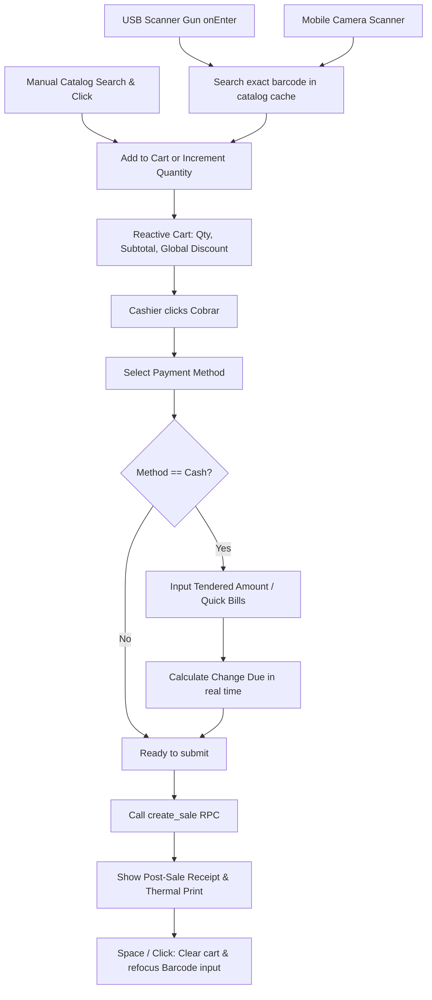

# Design: Fast Point of Sale (POS) Checkout Flow

## Context

The Point of Sale (POS) screen is the most frequently used interface in a minimarket. During peak hours, seconds matter: cashiers need to scan barcodes, adjust quantities, select payment methods, and calculate change without UI latency or multi-step friction. 

Crucially, product prices and costs fluctuate over time. Storing foreign keys to `products` without freezing historical prices at the moment of sale invalidates financial reporting and gross margin calculations. Furthermore, sales must be strictly tied to an active cash register shift (`cash_shifts`), and stock decrements must occur atomically to prevent discrepancies.

## Goals / Non-Goals

**Goals:**
- Implement `sales` and `sale_items` tables with multi-tenant Row Level Security (RLS) linked to `businesses(id)`.
- Enforce immutable pricing snapshots (`product_name`, `barcode`, `unit_cost`, `unit_price`) on each sale item.
- Provide an atomic database function (`create_sale`) that:
  - Validates that an active `cash_shift` exists with `status = 'open'`.
  - Inserts the sale and line items in a single transaction.
  - Decrements `products.stock` atomically using row-level locking (`FOR UPDATE`).
  - Computes change due for cash payments.
- Build a responsive `/dashboard/pos` interface optimized for high throughput:
  - Autofocused input for USB barcode scanner guns (adding items or incrementing quantity on `Enter`).
  - Mobile camera scanner integration via `html5-qrcode`.
  - Quick catalog search by name or category.
  - Interactive cart supporting quantity manipulation, item removal, and global discount application ($ fixed or % percentage).
  - Rapid checkout modal with payment method selection (`Efectivo`, `Transferencia`, `Tarjeta Débito`, `Tarjeta Crédito`), quick bill buttons, and bold change calculation.
  - Printable post-sale receipt summary formatted for thermal printers (58mm/80mm) with instant "Nueva Venta" reset.

**Non-Goals:**
- Fiscal printer integrations (e.g., AFIP electronic invoice generation in Argentina or local tax authority webservices are deferred to an electronic billing module).
- Split payments across multiple methods in a single ticket (each sale uses a single primary payment method in this phase).
- Customer credit / accounts receivable ("fiado" ledger deferred to a customer credits module).

## Decisions

### 1. Database Architecture & Exact SQL Schema

```sql
-- Migration: supabase/migrations/20261118000003_pos_checkout_flow.sql

-- 1. Create sales table
create table if not exists public.sales (
  id uuid primary key default gen_random_uuid(),
  business_id uuid not null references public.businesses(id) on delete cascade,
  shift_id uuid not null references public.cash_shifts(id) on delete restrict,
  user_id uuid not null references auth.users(id),
  subtotal numeric(12, 2) not null check (subtotal >= 0),
  discount_amount numeric(12, 2) not null default 0.00 check (discount_amount >= 0),
  discount_type text check (discount_type in ('percentage', 'fixed') or discount_type is null),
  total_amount numeric(12, 2) not null check (total_amount >= 0),
  payment_method text not null check (payment_method in ('cash', 'transfer', 'debit_card', 'credit_card')),
  amount_tendered numeric(12, 2),
  change_due numeric(12, 2) not null default 0.00 check (change_due >= 0),
  status text not null default 'completed' check (status in ('completed', 'cancelled')),
  created_at timestamptz not null default now(),
  updated_at timestamptz not null default now()
);

-- Indexes for performance
create index if not exists idx_sales_business_created on public.sales(business_id, created_at desc);
create index if not exists idx_sales_shift_id on public.sales(shift_id);
create index if not exists idx_sales_user_id on public.sales(user_id);

-- 2. Create sale_items table (Immutable pricing snapshot)
create table if not exists public.sale_items (
  id uuid primary key default gen_random_uuid(),
  sale_id uuid not null references public.sales(id) on delete cascade,
  product_id uuid references public.products(id) on delete set null,
  product_name text not null,
  barcode text,
  quantity numeric(12, 2) not null check (quantity > 0),
  unit_cost numeric(12, 2) not null default 0.00 check (unit_cost >= 0),
  unit_price numeric(12, 2) not null default 0.00 check (unit_price >= 0),
  subtotal numeric(12, 2) not null check (subtotal >= 0),
  created_at timestamptz not null default now()
);

create index if not exists idx_sale_items_sale_id on public.sale_items(sale_id);
create index if not exists idx_sale_items_product_id on public.sale_items(product_id);

-- 3. Row Level Security Policies
alter table public.sales enable row level security;
alter table public.sale_items enable row level security;

-- Sales policies
create policy "Users can view sales for their business"
  on public.sales for select
  to authenticated
  using (business_id in (select public.get_user_business_ids()));

create policy "Staff can insert sales for their business"
  on public.sales for insert
  to authenticated
  with check (
    business_id in (select public.get_user_business_ids())
    and public.get_business_role(business_id) in ('owner', 'manager', 'cashier')
  );

-- Sale items policies
create policy "Users can view sale items for their business"
  on public.sale_items for select
  to authenticated
  using (
    exists (
      select 1 from public.sales s
      where s.id = sale_items.sale_id
      and s.business_id in (select public.get_user_business_ids())
    )
  );

create policy "Staff can insert sale items"
  on public.sale_items for insert
  to authenticated
  with check (
    exists (
      select 1 from public.sales s
      where s.id = sale_items.sale_id
      and s.business_id in (select public.get_user_business_ids())
      and public.get_business_role(s.business_id) in ('owner', 'manager', 'cashier')
    )
  );

-- 4. Atomic Sale Creation RPC
create or replace function public.create_sale(
  p_business_id uuid,
  p_items jsonb,
  p_payment_method text,
  p_discount_amount numeric default 0.00,
  p_discount_type text default null,
  p_amount_tendered numeric default null
)
returns jsonb
language plpgsql
security definer
set search_path = public
as $$
declare
  v_user_id uuid;
  v_shift_id uuid;
  v_subtotal numeric := 0.00;
  v_total numeric := 0.00;
  v_change_due numeric := 0.00;
  v_sale_id uuid;
  v_item jsonb;
  v_product_id uuid;
  v_qty numeric;
  v_price numeric;
  v_cost numeric;
  v_p_name text;
  v_barcode text;
  v_current_stock numeric;
  v_item_subtotal numeric;
begin
  v_user_id := auth.uid();
  if v_user_id is null then
    raise exception 'Unauthorized';
  end if;

  if not public.is_business_member(p_business_id) then
    raise exception 'User is not a member of this business';
  end if;

  -- 1. Validate active open cash register shift
  select id into v_shift_id
  from public.cash_shifts
  where business_id = p_business_id and status = 'open'
  limit 1;

  if v_shift_id is null then
    raise exception 'Cannot complete sale: Cash register is closed. Please open a shift before selling.';
  end if;

  if jsonb_array_length(p_items) = 0 then
    raise exception 'Sale must contain at least one item';
  end if;

  if p_payment_method not in ('cash', 'transfer', 'debit_card', 'credit_card') then
    raise exception 'Invalid payment method: %', p_payment_method;
  end if;

  -- 2. Calculate subtotal
  for v_item in select * from jsonb_array_elements(p_items)
  loop
    v_qty := coalesce((v_item->>'quantity')::numeric, 0);
    v_price := coalesce((v_item->>'unit_price')::numeric, 0);
    if v_qty <= 0 then
      raise exception 'Item quantity must be greater than zero';
    end if;
    v_subtotal := v_subtotal + (v_qty * v_price);
  end loop;

  v_total := greatest(0.00, v_subtotal - coalesce(p_discount_amount, 0.00));

  -- 3. Calculate change due for cash
  if p_payment_method = 'cash' then
    if p_amount_tendered is not null and p_amount_tendered < v_total then
      raise exception 'Amount tendered is less than total amount';
    end if;
    v_change_due := greatest(0.00, coalesce(p_amount_tendered, v_total) - v_total);
  end if;

  -- 4. Insert sales record
  insert into public.sales (
    business_id, shift_id, user_id, subtotal,
    discount_amount, discount_type, total_amount,
    payment_method, amount_tendered, change_due, status
  ) values (
    p_business_id, v_shift_id, v_user_id, v_subtotal,
    coalesce(p_discount_amount, 0.00), p_discount_type, v_total,
    p_payment_method, p_amount_tendered, v_change_due, 'completed'
  )
  returning id into v_sale_id;

  -- 5. Insert sale items and decrement stock
  for v_item in select * from jsonb_array_elements(p_items)
  loop
    v_product_id := nullif(v_item->>'product_id', '')::uuid;
    v_qty := (v_item->>'quantity')::numeric;
    v_price := (v_item->>'unit_price')::numeric;
    v_cost := coalesce((v_item->>'unit_cost')::numeric, 0.00);
    v_p_name := trim(coalesce(v_item->>'product_name', 'Articulo'));
    v_barcode := nullif(trim(coalesce(v_item->>'barcode', '')), '');
    v_item_subtotal := v_qty * v_price;

    -- Decrement stock atomically with row lock if product_id is tracked
    if v_product_id is not null then
      select stock into v_current_stock
      from public.products
      where id = v_product_id and business_id = p_business_id
      for update;

      if not found then
        raise exception 'Product % does not belong to this business', v_product_id;
      end if;

      update public.products
      set stock = stock - v_qty,
          updated_at = now()
      where id = v_product_id;
    end if;

    insert into public.sale_items (
      sale_id, product_id, product_name, barcode,
      quantity, unit_cost, unit_price, subtotal
    ) values (
      v_sale_id, v_product_id, v_p_name, v_barcode,
      v_qty, v_cost, v_price, v_item_subtotal
    );
  end loop;

  return jsonb_build_object(
    'sale_id', v_sale_id,
    'total_amount', v_total,
    'change_due', v_change_due,
    'status', 'completed'
  );
end;
$$;
```

### 2. High-Speed POS Screen Architecture (`/dashboard/pos`)



### 3. Screen Decomposition & Ergonomics

- **Layout Grid**:
  - **Desktop (`lg:grid lg:grid-cols-12`)**:
    - Left column (7 cols): Barcode scanner bar + Search input + Product grid/cards filtered by category pills.
    - Right column (5 cols): Sticky Cart sidebar + Order breakdown + Checkout action.
  - **Mobile (`< lg`)**:
    - Viewport: Full-width product search & catalog.
    - Floating bottom bar: Cart counter, Total amount, and "Ver Carrito / Cobrar" button opening a bottom Sheet/Drawer.
- **Barcode Input**:
  - Top full-width bar with auto-focus on load.
  - `onKeyDown`: captures `Enter` without submitting page forms, parses string, adds item to cart, clears input value, and restores focus.
  - Camera scanner button: opens camera viewfinder modal via `html5-qrcode` (dynamic import to minimize bundle size).
- **Checkout Modal ("Cobrar")**:
  - Prominent Total amount formatted in business currency (`ARS` / `USD`).
  - Four payment method buttons: `Efectivo`, `Transferencia`, `Tarjeta Débito`, `Tarjeta Crédito`.
  - Cash mode options:
    - Quick bill chips (`Exacto`, `+$1.000`, `+$2.000`, `+$5.000`, `+$10.000`, `+$20.000`).
    - Large green banner: `Vuelto: $X.XX`.
  - Confirmation button calling `create_sale` RPC.
- **Post-Sale Receipt Modal**:
  - Store Name, Date & Time, Ticket #.
  - Itemized list, Subtotal, Discount, Total, Payment Method, Tendered & Change.
  - Clean print stylesheet (`@media print` formatted for 58mm / 80mm thermal printers).
  - Primary button: "Nueva Venta" (keyboard shortcut `Space` / `Enter` for instant consecutive transactions).

## Risks / Trade-offs

- **Selling with Closed Cash Register**:
  - *Risk*: A cashier forgets to open the register and rings up a queue of customers, only to have the sale fail.
  - *Mitigation*: The `/dashboard/pos` screen checks active shift state immediately. If closed, it renders a friendly banner with an immediate shortcut to open the register with one click.
- **Negative Stock**:
  - *Risk*: Minimarkets occasionally sell items when incoming merchandise hasn't yet been entered into the inventory system.
  - *Decision*: We allow stock to become negative with a warning flag rather than blocking the customer transaction at the checkout counter, prioritizing speed and merchant revenue over strict inventory stoppage.
- **Camera Scanner Permissions**:
  - *Risk*: Camera permissions blocked on mobile web.
  - *Mitigation*: Handled gracefully with fallback instruction directing users to manual search or USB scanner guns.
