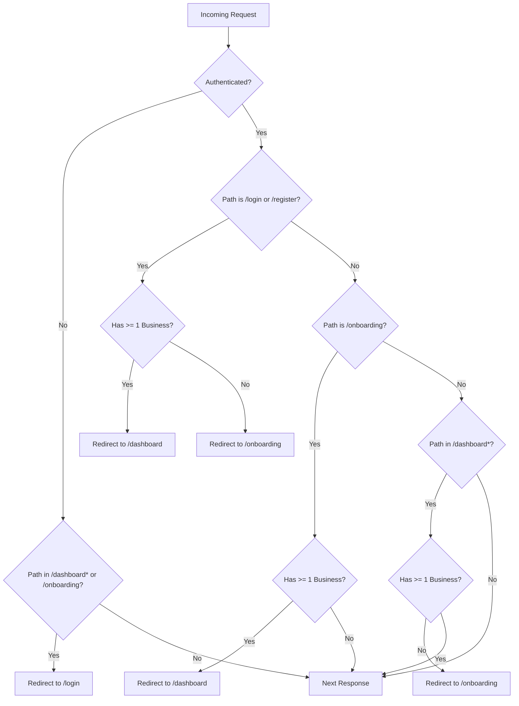

# Design: Setup Auth and Business Tenancy

## Context

The system is a Point of Sale (POS) and inventory manager tailored for minimarkets and local retail businesses (inspired by Treinta). It is built with Next.js 16 (App Router, React 19, TypeScript), Tailwind CSS, shadcn/ui, and Supabase (Auth, PostgreSQL with strict Row Level Security).

Prior to this change, no tenant isolation, authentication screens, or dashboard layout structures were implemented. The application must guarantee complete data segregation between businesses from day one.

## Goals / Non-Goals

**Goals:**
- Provide secure user registration and login using Supabase Auth (email and password).
- Ensure zero data leakage across organizations via strict PostgreSQL Row Level Security (RLS).
- Guarantee atomic business creation and initial `owner` membership assignment via a database function (RPC).
- Automate onboarding redirection so authenticated users without a business are immediately routed to `/onboarding`.
- Deliver a responsive navigation shell inspired by Treinta (desktop sidebar and mobile drawer) with active business indicators and clear module navigation.
- Store database migrations as standard, repeatable SQL files under `supabase/migrations/`.

**Non-Goals:**
- Social/OAuth authentication providers (deferred to future changes).
- Invitation systems and multi-user team member invitation UI (covered in upcoming team management changes).
- Granular permissions within business modules (roles `owner`, `manager`, `cashier` are established now, but fine-grained operational checks happen in module-specific specs).

## Decisions

### 1. Database Architecture & Exact SQL Schema

We model multi-tenancy using two core tables: `businesses` and `business_members`. Every tenant-scoped entity in future modules will reference `businesses(id)`.

To avoid infinite recursion bugs common to PostgreSQL RLS when tables cross-reference each other, we utilize `SECURITY DEFINER` helper functions (`get_user_business_ids()`, `is_business_member()`, `get_business_role()`) configured with `SET search_path = public`.

```sql
-- Migration: supabase/migrations/20261118000000_setup_auth_and_business.sql

-- 1. Create businesses table
create table if not exists public.businesses (
  id uuid primary key default gen_random_uuid(),
  name text not null,
  industry text not null,
  currency text not null default 'ARS' check (currency in ('ARS', 'USD')),
  created_at timestamptz not null default now(),
  updated_at timestamptz not null default now()
);

-- Index for timestamp ordering
create index if not exists idx_businesses_created_at on public.businesses(created_at);

-- 2. Create business_members table
create table if not exists public.business_members (
  id uuid primary key default gen_random_uuid(),
  business_id uuid not null references public.businesses(id) on delete cascade,
  user_id uuid not null references auth.users(id) on delete cascade,
  role text not null check (role in ('owner', 'manager', 'cashier')),
  created_at timestamptz not null default now(),
  constraint uq_business_member unique (business_id, user_id)
);

-- Indexes for tenancy lookups
create index if not exists idx_business_members_user_id on public.business_members(user_id);
create index if not exists idx_business_members_business_id on public.business_members(business_id);

-- 3. Security Definer Helper Functions (Prevents RLS Recursion)
create or replace function public.get_user_business_ids()
returns setof uuid
language sql
security definer
stable
set search_path = public
as $$
  select business_id from public.business_members where user_id = auth.uid();
$$;

create or replace function public.is_business_member(p_business_id uuid)
returns boolean
language sql
security definer
stable
set search_path = public
as $$
  select exists (
    select 1 from public.business_members
    where business_id = p_business_id and user_id = auth.uid()
  );
$$;

create or replace function public.get_business_role(p_business_id uuid)
returns text
language sql
security definer
stable
set search_path = public
as $$
  select role from public.business_members
  where business_id = p_business_id and user_id = auth.uid()
  limit 1;
$$;

-- 4. Row Level Security (RLS) Policies
alter table public.businesses enable row level security;
alter table public.business_members enable row level security;

-- Businesses policies
create policy "Users can view businesses they are member of"
  on public.businesses for select
  to authenticated
  using (id in (select public.get_user_business_ids()));

create policy "Owners and managers can update business details"
  on public.businesses for update
  to authenticated
  using (public.get_business_role(id) in ('owner', 'manager'))
  with check (public.get_business_role(id) in ('owner', 'manager'));

create policy "Owners can delete their business"
  on public.businesses for delete
  to authenticated
  using (public.get_business_role(id) = 'owner');

-- Business members policies
create policy "Members can view membership within their businesses"
  on public.business_members for select
  to authenticated
  using (business_id in (select public.get_user_business_ids()));

create policy "Owners and managers can add members"
  on public.business_members for insert
  to authenticated
  with check (public.get_business_role(business_id) in ('owner', 'manager'));

create policy "Owners can update member roles"
  on public.business_members for update
  to authenticated
  using (public.get_business_role(business_id) = 'owner')
  with check (public.get_business_role(business_id) = 'owner');

create policy "Owners can remove members or members can remove themselves"
  on public.business_members for delete
  to authenticated
  using (public.get_business_role(business_id) = 'owner' or user_id = auth.uid());

-- 5. Atomic Onboarding RPC Function
create or replace function public.create_business_with_owner(
  p_name text,
  p_industry text,
  p_currency text default 'ARS'
)
returns jsonb
language plpgsql
security definer
set search_path = public
as $$
declare
  v_user_id uuid;
  v_business record;
begin
  v_user_id := auth.uid();
  if v_user_id is null then
    raise exception 'Unauthorized: user must be authenticated';
  end if;

  if trim(coalesce(p_name, '')) = '' then
    raise exception 'Business name cannot be empty';
  end if;

  if p_currency not in ('ARS', 'USD') then
    raise exception 'Invalid currency. Must be ARS or USD';
  end if;

  -- Create business
  insert into public.businesses (name, industry, currency)
  values (trim(p_name), trim(p_industry), p_currency)
  returning id, name, industry, currency, created_at into v_business;

  -- Insert owner membership
  insert into public.business_members (business_id, user_id, role)
  values (v_business.id, v_user_id, 'owner');

  return jsonb_build_object(
    'id', v_business.id,
    'name', v_business.name,
    'industry', v_business.industry,
    'currency', v_business.currency,
    'role', 'owner'
  );
end;
$$;
```

### 2. Next.js & Supabase SSR Integration Architecture

We configure `@supabase/ssr` with three distinct clients:
1. `src/lib/supabase/client.ts`: Browser client for client-side interactions.
2. `src/lib/supabase/server.ts`: Server client consuming Next.js `cookies()` for Server Components, Server Actions, and Route Handlers.
3. `src/middleware.ts`: Edge middleware using `@supabase/ssr` to refresh session tokens and evaluate route protection rules.

#### Redirection & Routing Logic in Middleware


### 3. Treinta-Inspired Dashboard Layout Structure

The layout adopts the Treinta aesthetic (clean slate/black background with energetic amber/yellow accents):

- **Sidebar (Desktop - `lg:flex`)**:
  - Top header: Business switcher showing current business name, avatar/initials, and industry badge.
  - Navigation list:
    - Inicio (`/dashboard`)
    - Movimientos (`/dashboard/transactions`)
    - Inventario (`/dashboard/inventory`)
    - Caja (`/dashboard/cash`)
    - Reportes (`/dashboard/reports`)
    - Configuración (`/dashboard/settings`)
  - Bottom section: User email and distinct "Cerrar sesión" button.
- **Top Bar (Mobile - `< lg`)**:
  - Sticky header with current business name and hamburger button.
  - Sheet/Drawer component holding the identical navigation list and logout trigger.
- **Active Business State**:
  - Read from active business membership. If user belongs to multiple businesses, cookie `pos_active_business_id` specifies the selection; defaults to the first business if unset.

## Risks / Trade-offs

- **Middleware DB query overhead**:
  - *Risk*: Querying business memberships on every request in Next.js middleware could increase edge latency.
  - *Mitigation*: Query only membership existence (`limit 1`) using the session token, or cache tenant status in a signed, short-lived cookie (`pos_has_business=true`).
- **RLS Recursion**:
  - *Risk*: Direct sub-queries between `businesses` and `business_members` in policy definitions lead to PostgreSQL execution recursion errors.
  - *Mitigation*: The `SECURITY DEFINER` function `public.get_user_business_ids()` breaks the query plan recursion cleanly.
- **Client Direct Inserts**:
  - *Risk*: A client attempting direct `INSERT` on `businesses` could leave orphaned businesses without an owner.
  - *Mitigation*: Direct insert policies on `businesses` are omitted; business creation is strictly gated through the atomic `create_business_with_owner` RPC.
