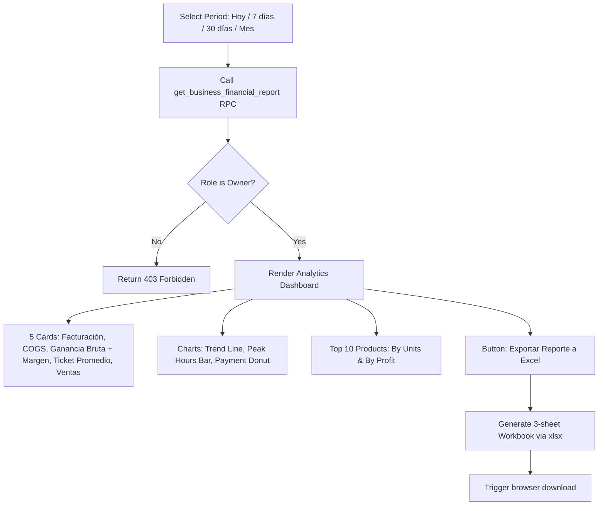

# Design: Team Role-Based Access Control and Financial Reports

## Context

In retail management, scaling from a single-operator store to a staffed minimarket requires strict access boundaries. Store owners must protect confidential commercial margins, product cost prices, and overall profit figures from cashier personnel. Additionally, owners need clear, visual business intelligence to analyze profitability, recognize peak transaction hours, identify best-selling products, and export clean financial spreadsheets.

This design introduces the `business_invitations` domain, implements multi-layered Role-Based Access Control (RBAC), and constructs an owner-exclusive analytics suite at `/dashboard/reports`.

## Goals / Non-Goals

**Goals:**
- Implement `business_invitations` table enabling owners to invite staff with roles `manager` or `cashier`.
- Enforce strict RBAC:
  - `cashier`: Restricted to POS (`/dashboard/pos`), Cash Register (`/dashboard/cash-register`), and stock-only view on Inventory (`/dashboard/inventory`). Server-side masking of `cost_price` and profit margins; 403 Forbidden on Reports, Movements history, and Team settings.
  - `manager`: Full inventory management (including cost prices), cash shifts, and movements; 403 Forbidden on Reports, Team management, and business deletion.
  - `owner`: Full unrestricted access.
- Build the Team Management view at `/dashboard/settings/team` (Owner only).
- Implement an analytical database function `get_business_financial_report` computing:
  - Gross Revenue: $\sum (\text{total\_amount})$
  - Cost of Goods Sold (COGS): $\sum (\text{quantity} \times \text{unit\_cost})$
  - Gross Profit: $\text{Gross Revenue} - \text{COGS}$
  - Gross Margin: $\frac{\text{Gross Profit}}{\text{Gross Revenue}} \times 100$
  - Average Order Value (AOV): $\frac{\text{Gross Revenue}}{\text{Sales Count}}$
  - Total Sales Count.
- Render interactive charts via Recharts (Daily sales curve, Peak hours distribution, Payment methods donut).
- Display Top 10 Best-Selling Products (sortable by units sold and by profit generated).
- Provide multi-tab Excel export (`xlsx`) with executive summary, top products, and itemized sales logs.

**Non-Goals:**
- Custom granular role builder (fixed roles `owner`, `manager`, `cashier` satisfy retail operational requirements).
- Payroll management or commission calculations per employee (deferred to employee commissions change).

## Decisions

### 1. Database Architecture & Exact SQL Schema

```sql
-- Migration: supabase/migrations/20261118000005_team_rbac_and_reports.sql

-- 1. Create business_invitations table
create table if not exists public.business_invitations (
  id uuid primary key default gen_random_uuid(),
  business_id uuid not null references public.businesses(id) on delete cascade,
  email text not null,
  role text not null check (role in ('manager', 'cashier')),
  token text not null unique default encode(gen_random_bytes(24), 'hex'),
  invited_by uuid not null references auth.users(id),
  status text not null default 'pending' check (status in ('pending', 'accepted', 'revoked')),
  expires_at timestamptz not null default (now() + interval '7 days'),
  created_at timestamptz not null default now(),
  constraint uq_pending_invite unique (business_id, email, status)
);

create index if not exists idx_business_invitations_token on public.business_invitations(token);
create index if not exists idx_business_invitations_business on public.business_invitations(business_id);

-- 2. Row Level Security Policies
alter table public.business_invitations enable row level security;

create policy "Owners can view and manage invitations for their business"
  on public.business_invitations for all
  to authenticated
  using (
    business_id in (select public.get_user_business_ids())
    and public.get_business_role(business_id) = 'owner'
  )
  with check (
    business_id in (select public.get_user_business_ids())
    and public.get_business_role(business_id) = 'owner'
  );

-- 3. Invitation Acceptance RPC
create or replace function public.accept_invitation(p_token text)
returns jsonb
language plpgsql
security definer
set search_path = public
as $$
declare
  v_user_id uuid;
  v_invite public.business_invitations;
begin
  v_user_id := auth.uid();
  if v_user_id is null then
    raise exception 'Unauthorized: User must be signed in to accept an invitation';
  end if;

  select * into v_invite
  from public.business_invitations
  where token = p_token and status = 'pending' and expires_at > now();

  if not found then
    raise exception 'Invitation is invalid or has expired';
  end if;

  -- Insert or update membership
  insert into public.business_members (business_id, user_id, role)
  values (v_invite.business_id, v_user_id, v_invite.role)
  on conflict (business_id, user_id)
  do update set role = v_invite.role;

  -- Mark invitation as accepted
  update public.business_invitations
  set status = 'accepted'
  where id = v_invite.id;

  return jsonb_build_object(
    'business_id', v_invite.business_id,
    'role', v_invite.role,
    'status', 'accepted'
  );
end;
$$;

-- 4. Analytical Financial Report Function
create or replace function public.get_business_financial_report(
  p_business_id uuid,
  p_start_date timestamptz,
  p_end_date timestamptz
)
returns jsonb
language plpgsql
security definer
stable
set search_path = public
as $$
declare
  v_role text;
  v_gross_revenue numeric := 0.00;
  v_cogs numeric := 0.00;
  v_gross_profit numeric := 0.00;
  v_margin_pct numeric := 0.00;
  v_sales_count integer := 0;
  v_aov numeric := 0.00;
  v_daily_trend jsonb;
  v_hourly_distribution jsonb;
  v_payment_methods jsonb;
  v_top_products jsonb;
begin
  v_role := public.get_business_role(p_business_id);
  if v_role <> 'owner' then
    raise exception 'Unauthorized: Only business owners can access financial reports';
  end if;

  -- 1. Headline KPIs
  select
    coalesce(sum(s.total_amount), 0.00),
    count(s.id)
  into v_gross_revenue, v_sales_count
  from public.sales s
  where s.business_id = p_business_id
    and s.status = 'completed'
    and s.created_at >= p_start_date
    and s.created_at <= p_end_date;

  select
    coalesce(sum(si.quantity * si.unit_cost), 0.00)
  into v_cogs
  from public.sale_items si
  join public.sales s on s.id = si.sale_id
  where s.business_id = p_business_id
    and s.status = 'completed'
    and s.created_at >= p_start_date
    and s.created_at <= p_end_date;

  v_gross_profit := v_gross_revenue - v_cogs;
  if v_gross_revenue > 0 then
    v_margin_pct := round(((v_gross_profit / v_gross_revenue) * 100)::numeric, 2);
    v_aov := round((v_gross_revenue / v_sales_count)::numeric, 2);
  end if;

  -- 2. Daily Sales Trend
  select jsonb_agg(d order by d.sale_date) into v_daily_trend
  from (
    select
      to_char(s.created_at, 'YYYY-MM-DD') as sale_date,
      coalesce(sum(s.total_amount), 0.00) as revenue,
      count(s.id) as count
    from public.sales s
    where s.business_id = p_business_id
      and s.status = 'completed'
      and s.created_at >= p_start_date
      and s.created_at <= p_end_date
    group by to_char(s.created_at, 'YYYY-MM-DD')
  ) d;

  -- 3. Peak Hours Distribution (8:00 - 23:00)
  select jsonb_agg(h order by h.hour_of_day) into v_hourly_distribution
  from (
    select
      extract(hour from s.created_at)::integer as hour_of_day,
      count(s.id) as sales_count,
      coalesce(sum(s.total_amount), 0.00) as revenue
    from public.sales s
    where s.business_id = p_business_id
      and s.status = 'completed'
      and s.created_at >= p_start_date
      and s.created_at <= p_end_date
    group by extract(hour from s.created_at)
  ) h;

  -- 4. Payment Method Breakdown
  select jsonb_agg(p) into v_payment_methods
  from (
    select
      s.payment_method,
      count(s.id) as count,
      coalesce(sum(s.total_amount), 0.00) as total
    from public.sales s
    where s.business_id = p_business_id
      and s.status = 'completed'
      and s.created_at >= p_start_date
      and s.created_at <= p_end_date
    group by s.payment_method
  ) p;

  -- 5. Top 10 Best-Selling Products
  select jsonb_agg(t) into v_top_products
  from (
    select
      si.product_name,
      sum(si.quantity) as units_sold,
      coalesce(sum(si.subtotal), 0.00) as revenue,
      coalesce(sum(si.quantity * si.unit_cost), 0.00) as cost,
      coalesce(sum(si.subtotal - (si.quantity * si.unit_cost)), 0.00) as profit
    from public.sale_items si
    join public.sales s on s.id = si.sale_id
    where s.business_id = p_business_id
      and s.status = 'completed'
      and s.created_at >= p_start_date
      and s.created_at <= p_end_date
    group by si.product_name
    order by profit desc
    limit 10
  ) t;

  return jsonb_build_object(
    'gross_revenue', v_gross_revenue,
    'cogs', v_cogs,
    'gross_profit', v_gross_profit,
    'margin_pct', v_margin_pct,
    'sales_count', v_sales_count,
    'aov', v_aov,
    'daily_trend', coalesce(v_daily_trend, '[]'::jsonb),
    'hourly_distribution', coalesce(v_hourly_distribution, '[]'::jsonb),
    'payment_methods', coalesce(v_payment_methods, '[]'::jsonb),
    'top_products', coalesce(v_top_products, '[]'::jsonb)
  );
end;
$$;
```

### 2. Multi-Layer RBAC Enforcement Matrix

| Domain & Route | `owner` | `manager` | `cashier` |
|---|---|---|---|
| `/dashboard/pos` | Unrestricted | Unrestricted | Unrestricted |
| `/dashboard/cash-register` | Unrestricted | Unrestricted | Operates Active Shift |
| `/dashboard/inventory` | Full CRUD + Cost & Margin | Full CRUD + Cost & Margin | View Stock & Sale Price only (**`cost_price` masked**) |
| `/dashboard/movements` | Full History & All Types | Full History & All Types | Current Shift Disbursements only |
| `/dashboard/reports` | Full Access | 403 Forbidden | 403 Forbidden |
| `/dashboard/settings/team` | Full Access | 403 Forbidden | 403 Forbidden |
| Navigation Shell Menu | Shows all items | Hides Reports & Team | Hides Reports, Movements & Team |

#### Sensitive Data Masking Mechanics
When serializing product lists for users holding the `cashier` role:
```typescript
export function sanitizeProductForRole(product: Product, role: BusinessRole): SanitizedProduct {
  if (role === 'cashier') {
    return {
      ...product,
      cost_price: null,
      margin_pct: null,
    };
  }
  return product;
}
```

### 3. Reports Screen Architecture (`/dashboard/reports`)



### 4. Excel Export Specification (`xlsx`)

The generated workbook `Reporte_Financiero_<Business>_<Period>.xlsx` consists of three formatted sheets:
1. `Resumen Ejecutivo`: Metadata, Period, Gross Revenue, COGS, Gross Profit, Gross Margin (%), AOV, Total Sales.
2. `Top Productos`: Columns for Product Name, Units Sold, Total Revenue, Total Cost, Total Profit, Margin (%).
3. `Detalle de Ventas`: Date, Ticket ID, Payment Method, Subtotal, Discount, Net Total, Line Items Count.

## Risks / Trade-offs

- **Aggregation Load on Large Datasets**:
  - *Risk*: Calculating COGS and product rankings over multi-month intervals across hundreds of thousands of items could be CPU intensive.
  - *Mitigation*: The `get_business_financial_report` function uses indexed timestamp lookups on `sales(business_id, created_at)` and limits top products with `LIMIT 10`.
- **Security Definer Privilege Escalation**:
  - *Risk*: `get_business_financial_report` runs with `SECURITY DEFINER`.
  - *Mitigation*: Explicit authorization check at the very beginning of the function: `if public.get_business_role(p_business_id) <> 'owner' then raise exception 'Unauthorized'`.
