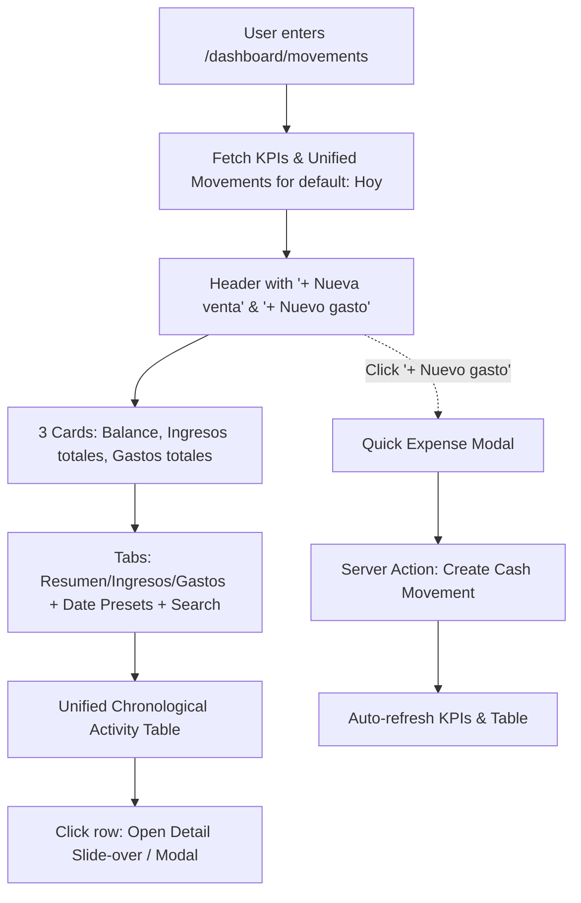

# Design: Track Cash Movements and Unified Daily Ledger

## Context

In retail management (exemplified by the Treinta interface), the primary financial dashboard is the daily movements ledger. Small merchants execute numerous non-POS transactions daily: paying bread and dairy distributors in cash at the counter, paying electricity and water bills, taking owner salary advances, or receiving bank transfers. 

Without unifying these cash movements with POS sales, daily ledger reconciliations are fragmented and cash shifts fail to reflect true drawer contents. This design provides the `cash_movements` table, links cash expenses to the active `cash_shifts` drawer balance, and constructs a unified chronological activity ledger at `/dashboard/movements`.

## Goals / Non-Goals

**Goals:**
- Implement `cash_movements` table with multi-tenant Row Level Security (RLS) linked to `businesses(id)`.
- Enable optional linking between `cash_movements` and active `cash_shifts` (specifically for cash disbursements).
- Update the cash shift expected balance computation:
  $$\text{Expected Cash} = \text{Initial Float} + \text{Cash Sales} + \text{Cash Incomes} - \text{Cash Expenses}$$
- Build the `/dashboard/movements` screen featuring:
  - Header with `+ Nueva venta` (linking to `/dashboard/pos`) and `+ Nuevo gasto` (modal).
  - Quick Expense Modal supporting categories (Proveedores, Servicios, Alquiler, Retiro de efectivo, Mantenimiento, Otro).
  - Movement type tabs: `Resumen`, `Ingresos`, and `Gastos`.
  - Date presets filter: `Hoy`, `Esta semana`, `Este mes`, and `Personalizado` date picker.
  - Three KPI cards: **Balance** (Net Cash Flow), **Ingresos totales**, and **Gastos totales**.
  - Unified chronological ledger combining `sales` and `cash_movements` with color-coded figures and detailed slide-over/dialog inspection.

**Non-Goals:**
- Double-entry accounting journal entries (debits/credits) with general ledger account numbering (unnecessary complexity for minimarkets).
- Recurring automated bill scheduling or bank API synchronization.

## Decisions

### 1. Database Architecture & Exact SQL Schema

```sql
-- Migration: supabase/migrations/20261118000004_track_cash_movements.sql

-- 1. Create cash_movements table
create table if not exists public.cash_movements (
  id uuid primary key default gen_random_uuid(),
  business_id uuid not null references public.businesses(id) on delete cascade,
  shift_id uuid references public.cash_shifts(id) on delete set null,
  user_id uuid not null references auth.users(id),
  type text not null check (type in ('income', 'expense')),
  category text not null default 'general',
  concept text not null,
  amount numeric(12, 2) not null check (amount > 0),
  payment_method text not null check (payment_method in ('cash', 'transfer', 'debit_card', 'credit_card')),
  created_at timestamptz not null default now(),
  updated_at timestamptz not null default now()
);

-- Indexes for performance
create index if not exists idx_cash_movements_business_created
  on public.cash_movements(business_id, created_at desc);
create index if not exists idx_cash_movements_shift_id
  on public.cash_movements(shift_id);
create index if not exists idx_cash_movements_type
  on public.cash_movements(business_id, type);

-- 2. Row Level Security Policies
alter table public.cash_movements enable row level security;

create policy "Users can view cash movements for their business"
  on public.cash_movements for select
  to authenticated
  using (business_id in (select public.get_user_business_ids()));

create policy "Staff can insert cash movements for their business"
  on public.cash_movements for insert
  to authenticated
  with check (
    business_id in (select public.get_user_business_ids())
    and public.get_business_role(business_id) in ('owner', 'manager', 'cashier')
  );

create policy "Owners and managers can update or delete cash movements"
  on public.cash_movements for update
  to authenticated
  using (
    business_id in (select public.get_user_business_ids())
    and public.get_business_role(business_id) in ('owner', 'manager')
  );

-- 3. Live Shift Cash Balance Calculation Function
create or replace function public.get_shift_cash_balance(p_shift_id uuid)
returns jsonb
language plpgsql
security definer
stable
set search_path = public
as $$
declare
  v_shift public.cash_shifts;
  v_cash_sales numeric := 0.00;
  v_cash_incomes numeric := 0.00;
  v_cash_expenses numeric := 0.00;
  v_digital_sales numeric := 0.00;
  v_expected_cash numeric := 0.00;
begin
  select * into v_shift from public.cash_shifts where id = p_shift_id;
  if not found then
    return null;
  end if;

  -- Sum cash sales
  select coalesce(sum(total_amount), 0.00) into v_cash_sales
  from public.sales
  where shift_id = p_shift_id and payment_method = 'cash' and status = 'completed';

  -- Sum non-cash sales
  select coalesce(sum(total_amount), 0.00) into v_digital_sales
  from public.sales
  where shift_id = p_shift_id and payment_method <> 'cash' and status = 'completed';

  -- Sum cash movements (manual income and expenses)
  select coalesce(sum(amount), 0.00) into v_cash_incomes
  from public.cash_movements
  where shift_id = p_shift_id and type = 'income' and payment_method = 'cash';

  select coalesce(sum(amount), 0.00) into v_cash_expenses
  from public.cash_movements
  where shift_id = p_shift_id and type = 'expense' and payment_method = 'cash';

  v_expected_cash := v_shift.initial_cash + v_cash_sales + v_cash_incomes - v_cash_expenses;

  return jsonb_build_object(
    'initial_cash', v_shift.initial_cash,
    'cash_sales', v_cash_sales,
    'digital_sales', v_digital_sales,
    'cash_incomes', v_cash_incomes,
    'cash_expenses', v_cash_expenses,
    'expected_cash', v_expected_cash
  );
end;
$$;

-- 4. Unified Movements RPC
create or replace function public.get_unified_movements(
  p_business_id uuid,
  p_start_date timestamptz default null,
  p_end_date timestamptz default null,
  p_type text default null,
  p_payment_method text default null,
  p_search text default null,
  p_limit integer default 100,
  p_offset integer default 0
)
returns table (
  id uuid,
  source text,
  type text,
  category text,
  concept text,
  amount numeric,
  payment_method text,
  created_at timestamptz,
  user_id uuid
)
language sql
security definer
stable
set search_path = public
as $$
  with combined as (
    -- POS Sales as income
    select
      s.id,
      'sale'::text as source,
      'income'::text as type,
      'Venta POS'::text as category,
      concat('Venta #', substring(s.id::text, 1, 8)) as concept,
      s.total_amount as amount,
      s.payment_method,
      s.created_at,
      s.user_id
    from public.sales s
    where s.business_id = p_business_id
      and s.status = 'completed'
      and (p_start_date is null or s.created_at >= p_start_date)
      and (p_end_date is null or s.created_at <= p_end_date)
      and (p_payment_method is null or s.payment_method = p_payment_method)
      and (p_type is null or p_type = 'income')

    union all

    -- Manual cash movements (expenses & manual incomes)
    select
      m.id,
      'movement'::text as source,
      m.type,
      m.category,
      m.concept,
      m.amount,
      m.payment_method,
      m.created_at,
      m.user_id
    from public.cash_movements m
    where m.business_id = p_business_id
      and (p_start_date is null or m.created_at >= p_start_date)
      and (p_end_date is null or m.created_at <= p_end_date)
      and (p_payment_method is null or m.payment_method = p_payment_method)
      and (p_type is null or m.type = p_type)
      and (p_search is null or m.concept ilike concat('%', p_search, '%'))
  )
  select * from combined
  order by created_at desc
  limit p_limit offset p_offset;
$$;
```

### 2. UI Layout & Component Architecture (`/dashboard/movements`)



### 3. Screen Decomposition

- **Header Toolbar**:
  - Title: `Movimientos`
  - Action buttons:
    - `+ Nueva venta`: styled with green/slate accent, routes to `/dashboard/pos`.
    - `+ Nuevo gasto`: styled with energetic amber accent, opens Expense modal.
- **Financial KPI Cards (3 Grid)**:
  - `Balance`: $\text{Ingresos} - \text{Gastos}$ (styled bold green if $\ge 0$, red if $< 0$).
  - `Ingresos totales`: Total inflows in period.
  - `Gastos totales`: Total outflows in period.
- **Filter Bar**:
  - Tabs: `Resumen` (All), `Ingresos` (Incomes only), `Gastos` (Expenses only).
  - Date Presets: `Hoy` (default), `Esta semana`, `Este mes`, `Personalizado` (popover date range picker).
  - Payment method dropdown: `Todos`, `Efectivo`, `Transferencia`, `Tarjeta Débito`, `Tarjeta Crédito`.
  - Concept search: debounced text input.
- **Quick Expense Modal**:
  - Form Fields:
    - Concept / Description (e.g., "Pago a proveedor Lácteos", "Factura de Luz").
    - Amount ($) with currency prefix.
    - Category dropdown: `Proveedores`, `Servicios / Impuestos`, `Alquiler`, `Retiro de efectivo`, `Mantenimiento`, `Otro`.
    - Payment method selector.
    - If payment method is `Efectivo` and register is open: Checkbox "Afectar caja actual" (pre-checked).
- **Unified Activity Table**:
  - Columns: Fecha/Hora, Tipo & Categoría, Concepto, Método de pago, Monto (`+$X.XX` en verde o `-$X.XX` en rojo).
  - Click row: reveals detail modal/drawer with item list (if sale) or notes/user details (if manual movement).

## Risks / Trade-offs

- **Performance of Combined Query**:
  - *Risk*: A unified query combining millions of sales and movements could slow down the page.
  - *Mitigation*: The `get_unified_movements` function scopes records by indexed `business_id` and date range (`created_at`) with explicit pagination (`LIMIT 100 OFFSET 0`).
- **Shift Link Disconnection**:
  - *Risk*: An expense paid in cash when no shift is open is recorded with `shift_id = null`.
  - *Mitigation*: This accurately reflects reality: drawer reconciliation only factors in money taken while that specific drawer shift was active.
